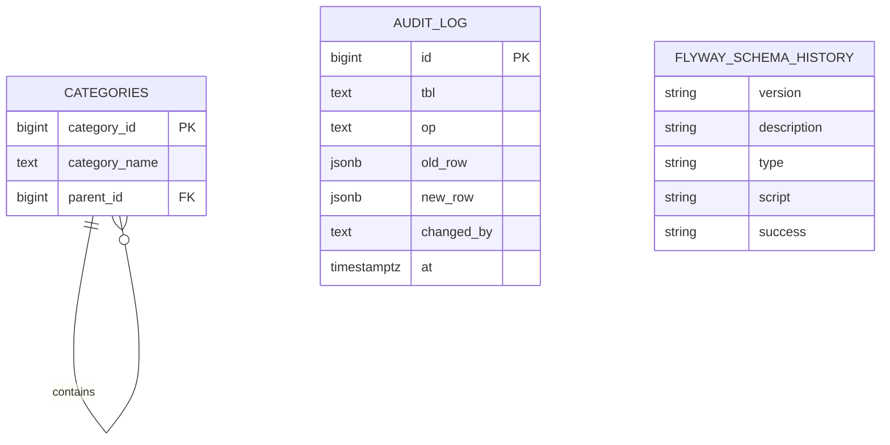

# Entity Relationship Diagram — Audit Logging and Safe Migrations

## 1. Entities

### AUDIT_LOG
- `id` — Primary Key
- `tbl` — Name of the affected table
- `op` — Operation performed (INSERT, UPDATE, DELETE)
- `old_row` — Previous row data (JSONB)
- `new_row` — New row data (JSONB)
- `changed_by` — Database user who performed the operation
- `at` — Date and time of the change

### CATEGORIES
- `category_id` — Primary Key
- `category_name` — Category name
- `parent_id` — Foreign Key referencing `CATEGORIES.category_id`; nullable for top-level categories

### FLYWAY SCHEMA HISTORY
Managed by Flyway. Records applied migrations, including version, description, execution status, and other migration metadata supported by the installed version.

## 2. Relationships

- **CATEGORIES to CATEGORIES:** One parent category can have zero or many child categories. Each child category can have zero or one parent.
- **AUDIT_LOG:** Stores change-event records. The `tbl` field identifies the affected table, so it is not a foreign-key relationship to every audited table.
- **FLYWAY SCHEMA HISTORY:** Managed independently by Flyway; it tracks schema migration execution rather than individual data changes.

## 3. Mermaid ER Diagram

## 4. Design Notes
- Audit logs record important data changes.
- Category hierarchy uses a self-referencing foreign key.
- Flyway maintains its own migration history table.
- The exact category column definitions must match the existing database schema.
- The ER diagram describes the intended design and must be checked against the actual database before implementation.

